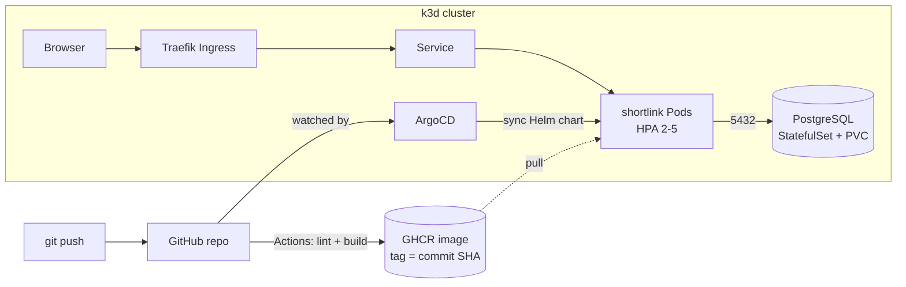
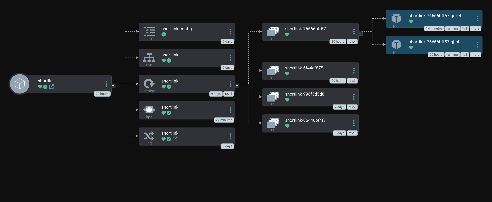
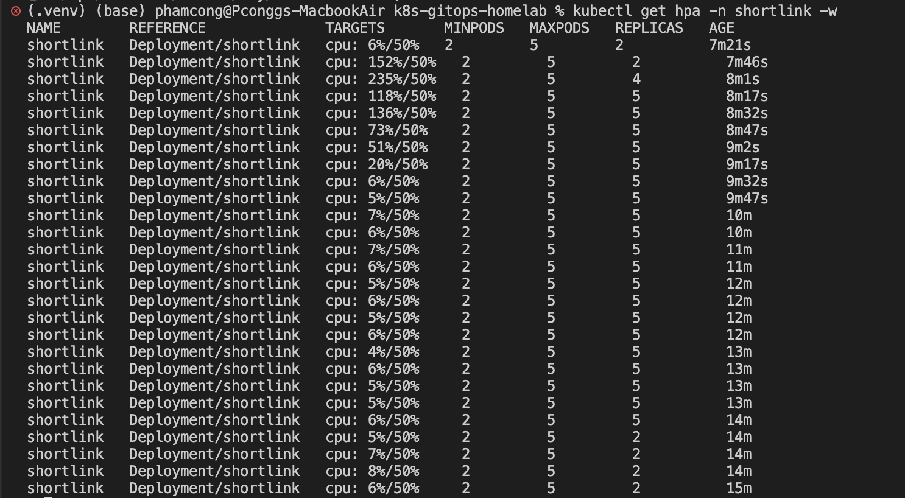

# k8s-gitops-homelab

A Kubernetes homelab on a MacBook Air M1: a Python URL shortener with PostgreSQL, packaged with Helm, locked down with NetworkPolicy, built by GitHub Actions and deployed by ArgoCD (GitOps).


## Architecture



## Tech stack

| Layer | Tools |
|---|---|
| Cluster | k3d (k3s in Docker), Colima |
| App | Python Flask, Gunicorn, PostgreSQL |
| Packaging | Docker (non-root, multi-arch), Helm |
| Networking | Traefik Ingress, NetworkPolicy (default-deny) |
| Security | securityContext (runAsNonRoot, read-only root FS, drop ALL capabilities), Secret |
| CI/CD | GitHub Actions, GHCR, ArgoCD (auto-sync, self-heal) |
| Scaling | metrics-server, HorizontalPodAutoscaler |

## What this project demonstrates

**Network segmentation.** A default-deny NetworkPolicy blocks all traffic, then only four paths are opened: DNS, Traefik → app (8000), app → PostgreSQL (5432). Every rule was verified with test pods, including an attacker pod in another namespace. Full results: [docs/networkpolicy-tests.md](docs/networkpolicy-tests.md).

| Source | Destination | Result |
|---|---|---|
| User via Ingress | app | ✅ allowed |
| Pod in another namespace | PostgreSQL | ❌ blocked |
| Pod in another namespace | app (bypassing Ingress) | ❌ blocked |
| app | Internet | ❌ blocked |

**GitOps.** Every push to `main` that touches `app/` runs lint, then builds a multi-arch image tagged with the commit SHA. ArgoCD syncs the Helm chart from Git. Scaling the deployment by hand with `kubectl` is reverted within seconds (self-heal), so Git stays the single source of truth.



**Autoscaling.** Under load (`hey`, 30 concurrent users for 90s), CPU rose to 235% of the request and the HPA scaled from 2 to 5 pods within about 30 seconds. After the load stopped, it waited the 5-minute stabilization window before scaling back to 2.



**Stateless app, stateful database.** All app pods share one PostgreSQL instance on a PersistentVolume, so any pod can serve any link, and data survives pod deletion. Readiness checks the database; liveness does not, so a database outage removes pods from the Service without restarting them.

## Repository structure

```
app/                 Flask app + Dockerfile
charts/shortlink/    Helm chart (values.yaml, values-dev.yaml, values-prod.yaml)
k8s/                 Infrastructure outside the chart: namespace, PostgreSQL, NetworkPolicy
gitops/              ArgoCD Application
.github/workflows/   CI pipeline
docs/                Test evidence, decision records, screenshots
```

## Quick start

Create the local cluster:

```bash
colima start --cpu 2 --memory 4
k3d cluster create homelab --agents 1 -p "8080:80@loadbalancer"
```

Deploy infrastructure (namespace, PostgreSQL, NetworkPolicy):

```bash
kubectl apply -f k8s/namespace.yaml
kubectl create secret generic postgres-secret -n shortlink --from-literal=POSTGRES_PASSWORD=<your-password>
kubectl apply -f k8s/
```

Install ArgoCD and hand the app over to GitOps:

```bash
kubectl create namespace argocd
kubectl apply -n argocd --server-side -f https://raw.githubusercontent.com/argoproj/argo-cd/stable/manifests/install.yaml
kubectl apply -f gitops/application.yaml
```

Open the app at http://shortlink.localhost:8080

Stop / start / delete:

```bash
k3d cluster stop homelab && colima stop
colima start && k3d cluster start homelab
k3d cluster delete homelab
```

## Design decisions

- [0001 – k3d instead of minikube, kind or EKS](docs/decisions/0001-k3d.md)
- [0002 – GitOps with ArgoCD instead of deploying from CI](docs/decisions/0002-argocd-gitops.md)
- [0003 – PostgreSQL kept outside the Helm chart](docs/decisions/0003-postgres-outside-chart.md)

## Progress

- [x] Phase 0: Setup
- [x] Phase 1: Containerize the app
- [x] Phase 2: Kubernetes basics
- [x] Phase 3: Ingress and database
- [x] Phase 4: Helm
- [x] Phase 5: NetworkPolicy
- [x] Phase 6: CI and GitOps
- [x] Phase 7: Autoscaling and docs

## Author

Phạm Lê Chí Công · [@KidPcongg](https://github.com/KidPcongg)